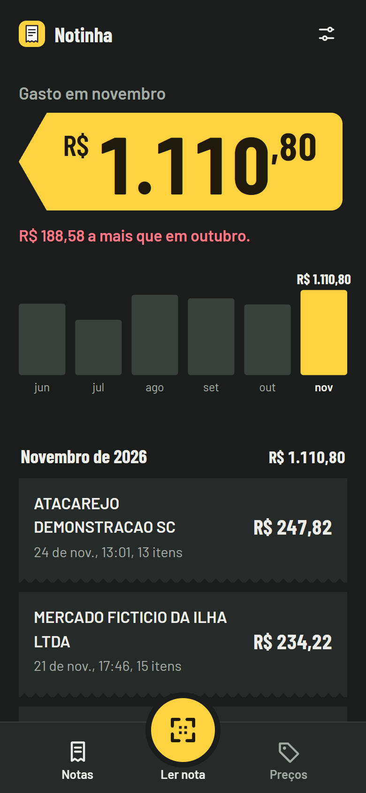
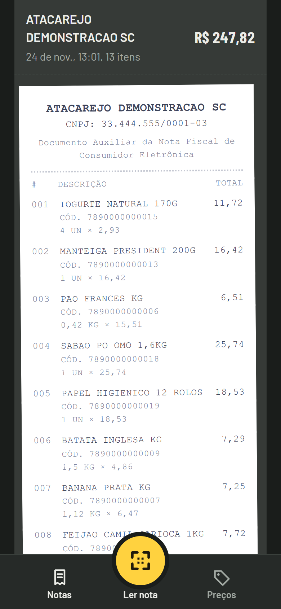
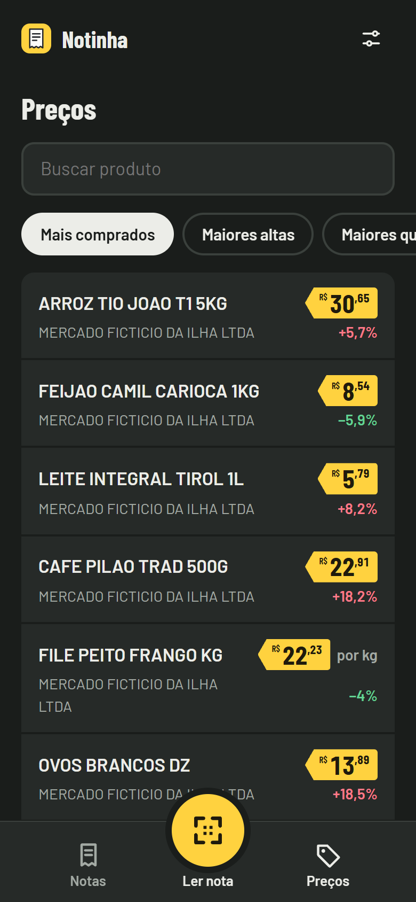
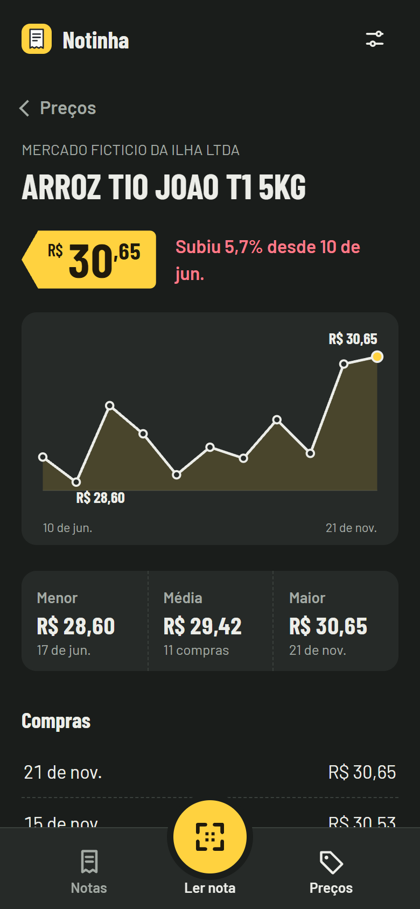

# Notinha

Leia o QR Code da nota do mercado (NFC-e de Santa Catarina) e acompanhe quanto você gasta
por mês e quanto cada produto subiu. Tudo fica no seu celular: sem conta, sem servidor, sem rastreio.

<p align="center">
  
  
  
  
</p>

| Tela | O que mostra |
|------|--------------|
| **Notas** | Gasto do mês, comparação com o mês anterior e barras dos últimos 6 meses. |
| **Nota aberta** | Cada nota abre como o cupom NFC-e impresso, com QR Code. |
| **Preços** | Produtos por mais comprados, maiores altas e maiores quedas. |
| **Produto** | Gráfico do preço ao longo do tempo, menor, média e maior. |

As imagens usam dados fictícios.

## Recursos

- Leitura do QR Code pela câmera ou por foto (jsQR).
- Funciona offline e pode ser instalado como app (PWA com service worker).
- Dados salvos no IndexedDB do aparelho; backup e restauração em JSON pelo ícone de ajustes.
- Apagar nota com opção de desfazer.

## Como usar

1. **Ler nota**: aponte a câmera para o QR Code (ou use uma foto).
2. **Abrir nota na SEFAZ**: passe pela verificação de segurança, toque e segure,
   **Selecionar tudo** e **Copiar**.
3. Volte ao Notinha e toque em **Colar nota**. Os itens são salvos no aparelho.

A SEFAZ de SC protege a consulta com captcha, por isso a nota é copiada por você,
e não buscada automaticamente.

## Rodar no computador

Não há build nem dependências. Sirva a pasta `web`:

```sh
cd web
python -m http.server 8080
```

Abra <http://localhost:8080>. A câmera só funciona em `localhost` ou em HTTPS; no celular,
publique no GitHub Pages (Settings → Pages → pasta `/web` via Actions ou copie para `docs/`).

## Testes

```sh
node --test web/js/
```

## Licenças

- [jsQR](https://github.com/cozmo/jsQR) (Apache-2.0): `web/vendor/jsQR.js`
- [qrcode-generator](https://github.com/kazuhikoarase/qrcode-generator) (MIT, Kazuhiko Arase): `web/vendor/qrcode.mjs`
- Fonte Barlow (SIL OFL 1.1): `web/fonts/`
